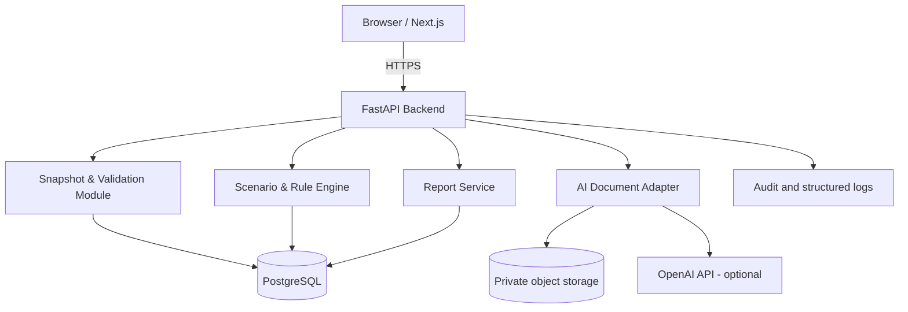

# System Architecture — Modular Monolith

## C4 level 1: system context
**Users:** issuer analyst, BAE analyst, reviewer; demo viewer. **System:** FloatPath. **External:** OpenAI API (optional), customer document source (authorized only), no real-time BEI/KSEI/Datindo integration in MVP.

## C4 level 2: containers

## Domain boundaries
`company`, `ownership`, `regulation`, `simulation`, `document`, `ai`, `report`, `identity` (pilot), `audit`. Each module exposes services/interfaces; avoid domain logic inside route handlers.

## Critical workflows
**Import:** file/manual → MIME/type validation → row parsing → reconciliation → candidate snapshot → human verification → lock & hash → audit event.  
**Simulation:** verified snapshot → selected scoped rules → apply transaction → recompute all owner eligibility → evaluate criteria → persist immutable result.  
**AI:** private source document → scan/parse → candidate extraction → schema validation → provenance validation → reviewer acceptance → (then) snapshot.  
**Report:** immutable result + data/engine version → neutral explanation → reviewer acceptance → watermark export.

## Authentication model
Public demo: read-only synthetic fixtures, no confidential file upload. Private pilot: SSO or passwordless/OIDC when requirements known; token auth, actor/tenant access, reviewer role. All query paths include tenant scope or dedicated data access checks.

## Deployment
Next.js web, FastAPI service, managed/self-hosted PostgreSQL, encrypted private storage, ingress TLS; separate demo/staging/pilot. Background queue for PDF extraction may be added later, no need for 5 microservices.

## Observability
Correlation ID on all API calls, request latency, AI cost/tokens, parsing latency, rule-version usage, expected/actual validations, no raw ownership PII in logs. Enforce alerts for repeated failures and suspicious uploads.

## Failure handling
API retries only idempotent operations; transactions for snapshot/scenario writes; stored job state for long parsing; never return partial compliance; OpenAI outage degrades to manual input and deterministic simulation.

## Performance objectives (initial, validate with measurement)
Local synthetic calculation p95 under 500ms at 10k holder rows; end-to-end PDF extraction asynchronous with progress; document size initial 10 MB; note these are provisional engineering targets, not established SLOs.

## Portability
CSV + REST adapter with explicit import contracts. Do not claim direct compatibility with Datindo .NET/ClickHouse/Next.js without vendor confirmation.
