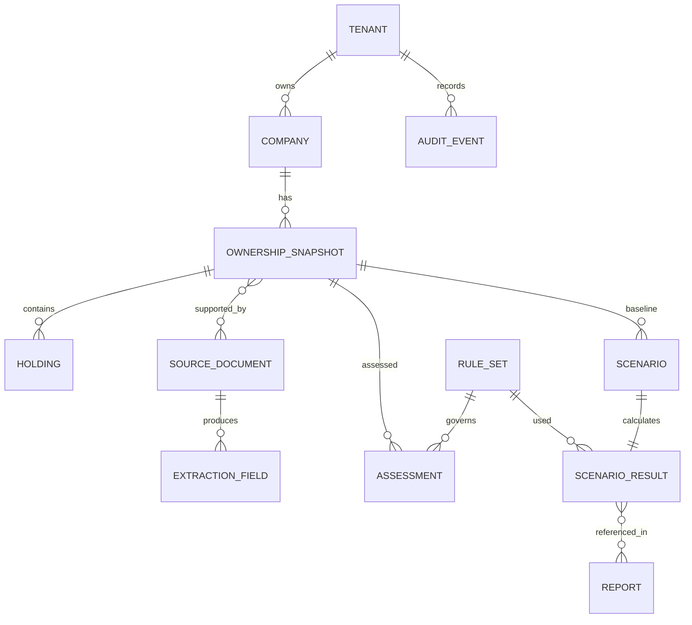

# Database Design / ERD

## ERD (logical)

## Tables: core keys & constraints
- `tenants(id, name, mode, created_at)`; demo tenant reserved.
- `companies(id, tenant_id, legal_name, ticker, board, demo, created_at)`, unique `(tenant_id,ticker)` only when ticker non-null.
- `ownership_snapshots(id, tenant_id, company_id, as_of_date, total_listed_shares BIGINT CHECK >0, verified_sid_count BIGINT NULL, reference_market_cap NUMERIC NULL, market_cap_as_of DATE NULL, status, hash, created_at, locked_at)`, immutable if locked.
- `holdings(id, tenant_id, snapshot_id, holder_ref, shares BIGINT CHECK >=0, eligibility, flag_json, verified_by, source_id)`, unique `(snapshot_id,holder_ref)`.
- `source_documents(id, tenant_id, sha256, mime_type, storage_key, license_basis, sensitivity, scan_status, uploaded_at, deleted_at)`; no publicly guessable keys.
- `extracted_fields(id, document_id, field_name, raw_text, normalized_json, page, bbox_json, status, model_version, reviewed_by)`.
- `rule_sets(id, rule_id, version, scope_json, source_id, source_clause, effective_from, effective_to, verified_by, status, hash)`.
- `assessments(id, snapshot_id, rule_set_id, input_hash, criteria_json, numeric_status, overall_status, created_at)`.
- `scenarios(id, snapshot_id, action_type, action_json, created_by, created_at, locked_at)`.
- `scenario_results(id, scenario_id, rule_set_id, input_hash, result_json, result_hash, created_at)`.
- `reports(id, tenant_id, scenario_result_ids_json, content_md, reviewed_by, watermark, created_at)`.
- `audit_events(id, tenant_id, actor_id, action, entity, entity_id, before_hash, after_hash, correlation_id, created_at)`.

## Integrity / operations
- Composite foreign keys or checked access enforce tenant consistency; defense-in-depth RLS in pilot.
- Store money/rates as PostgreSQL NUMERIC, shares as BIGINT; no float for rule decisions.
- Snapshot locking is transactionally coupled to checksum; any edit creates a new version.
- `company_snapshot` source document links many-to-many; persist source lineage and licensed use.
- Index `(tenant_id,company_id,as_of_date desc)`, `(tenant_id,snapshot_id)`, `(rule_id,version)`, `(document_id,status)`.
- Encrypt storage at rest, encrypt backups, test migration down/restore, retention per tenant.

## Versioning
Migrations with Alembic. Never modify historical approved assessment result: append superseding record with `supersedes_id` if correction required.
