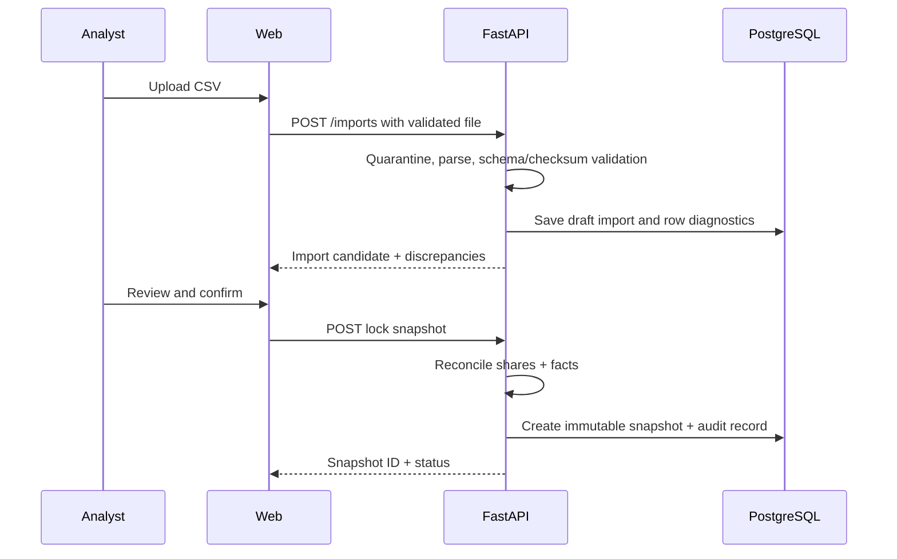
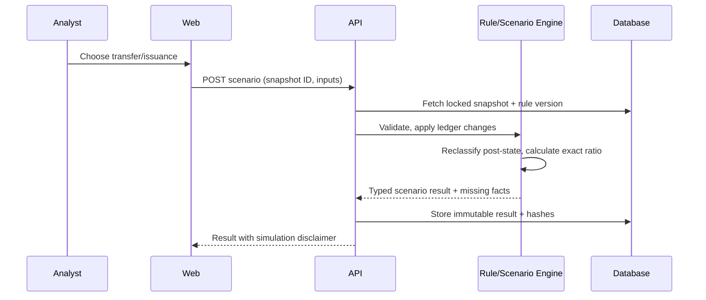
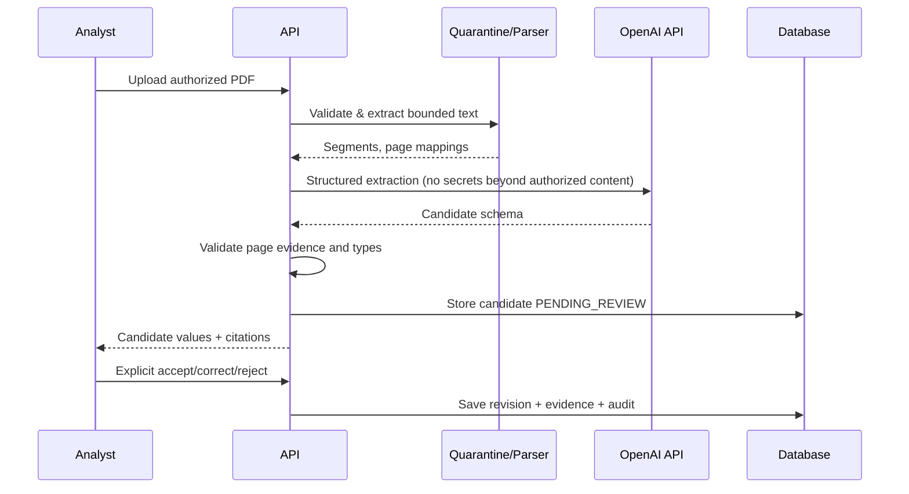

# Core System Sequence Diagrams

## 1. CSV import + locked snapshot

## 2. Deterministic scenario

## 3. AI candidate extraction + review

## Failure principles
- If model unavailable, manual ingestion and deterministic scenario still work.
- If data or rules unknown, return actionable missing facts, not success.
- Every tenant-specific query must apply server-side authorization and tenant scope.
- Never perform stock trades, external filing, or sending emails from these sequences.
